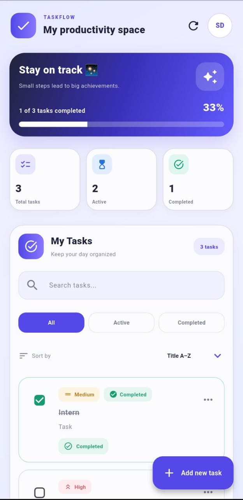

# TaskFlow  Flutter To-Do App


<p align="center">
  
  
  
  
  
  
</p>

<p align="center">
  A clean and practical task management app built with Flutter and Dart.
</p>


<p align="center">
  
</p>


## About the Project

**TaskFlow** is a Flutter-based to-do application designed to help users organize daily activities, manage tasks, and track their progress through a straightforward interface.

The app provides task management tools, search and filtering options, task priorities, and dashboard statistics. Local storage helps retain task information between app sessions.

This project was developed as part of the Flutter Development Internship at **Auspify Technologies — Task 02**.

## Features

- **Task Management** — Add, edit, delete, and complete tasks.
- **Task Priorities** — Organize tasks by priority.
- **Search** — Find tasks quickly.
- **Filters** — View all, active, or completed tasks.
- **Sorting** — Organize tasks using the available sorting options.
- **Dashboard Statistics** — View a summary of task progress.
- **Local Storage** — Retain tasks between app sessions.
- **Mobile-Friendly UI** — Designed for convenient use on a mobile device.

## Technology Stack

| Technology | Purpose |
|---|---|
| Flutter | Cross-platform UI framework |
| Dart | Application programming language |
| SharedPreferences | Local persistence |
| Flutter Test | Automated testing |
| Material Design | User interface components |

## Getting Started

### Prerequisites

- Flutter SDK
- Dart SDK
- Android Studio or VS Code
- An Android device or emulator

### Installation

Clone the repository:

```bash
git clone https://github.com/SilvaDeShakila/TaskFlow.git
```

Navigate to the project directory:

```bash
cd todo_list
```

Install dependencies:

```bash
flutter pub get
```

Run the application:

```bash
flutter run
```

## Testing and Code Quality

The project was checked using Flutter's development tools.

| Check | Result |
|---|---|
| Dependency installation | Passed |
| `flutter analyze` | No issues found |
| `flutter test --reporter expanded` | All tests passed |
| Manual testing on Android phone | Passed |

The current automated test output confirms that the included widget test passed. The test suite can be expanded to cover additional task-management scenarios.

## Build an Android APK

To create a release APK, run:

```bash
flutter build apk --release
```

The generated APK is available at:

```text
build/app/outputs/flutter-apk/app-release.apk
```

## Project Structure

```text
todo_list/
├── android/
├── assets/
├── lib/
├── test/
├── pubspec.yaml
├── pubspec.lock
└── README.md
```

*The structure above shows the main project locations; additional platform and configuration files may also be present.*

## Future Improvements

- Add reminders and notifications.
- Add optional cloud synchronization.
- Improve automated test coverage.
- Add more task organization and personalization options.

## Internship Project

**Organization:** Auspify Technologies  
**Programme:** Flutter Development Internship  
**Task:** Task 02 — To-Do List Application  
**Framework:** Flutter

## Author

**Shakila De Silva**

- GitHub: [SilvaDeShakila](https://github.com/SilvaDeShakila)

---

<p align="center">
  Built with Flutter and Dart.
</p>

